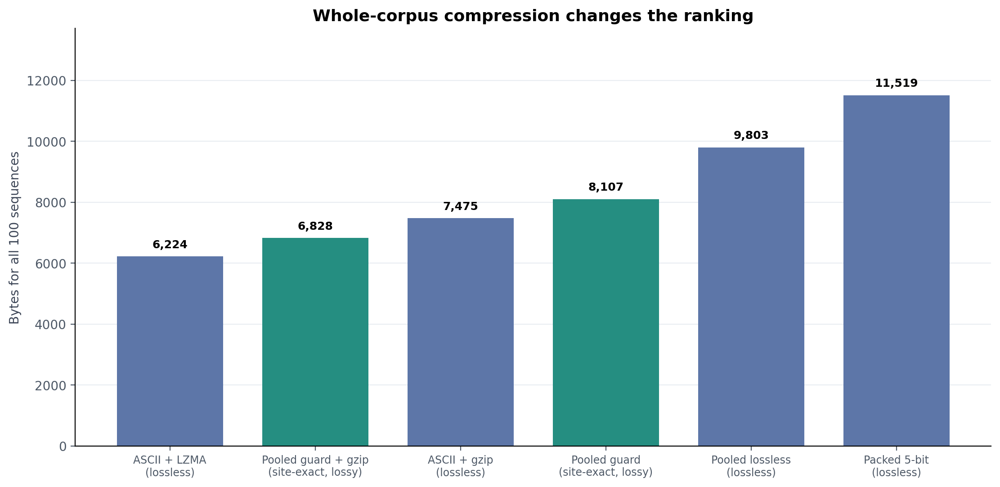

# Uniprot Instance Adaptive Compression

A small, reproducible Python + Lean 4 experiment. It stores selected corrections to
a homologous protein reference, guaranteeing that annotated functional-site
**residue identities** are reconstructed exactly.

**It does not prove that compressed proteins retain biochemical activity.**

## Headline results

| 100-protein corpus encoding | Bytes | Exact full sequences? |
| --- | ---: | :---: |
| Newline-separated ASCII + LZMA/XZ | **6,224** | Yes |
| Pooled feature-guarded archive + gzip | 6,828 | No; annotated sites exact |
| Newline-separated ASCII + gzip | 7,475 | Yes |
| Pooled feature-guarded archive | 8,107 | No; annotated sites exact |
| Pooled lossless archive | 9,803 | Yes |
| Standalone 5-bit amino-acid packing | 11,519 | Yes |

100 reviewed UniProt targets, 9 protein families, **511 annotated site features**.
Without correction, 505/511 had exact residues; with guarded correction,
**511/511** did. Only **6/100** real homolog comparisons actually challenged an
annotated site. The guarded pooled archive is **29.6% smaller** than five-bit
packing, but **lossless LZMA is smaller still**.



See [RESULTS.md](RESULTS.md) for assumptions, family breakdown and interpretation.

## Run locally

Python 3.10+ is sufficient for the codec, tests, and benchmark:

```bash
python3 -m unittest discover -s tests -v
python3 experiment.py
python3 pool_archive.py
```

To regenerate the charts (requires matplotlib and numpy):

```bash
python3 -m pip install -r requirements.txt
python3 plot_results.py
```

To kernel-check the abstract proof, install [Lean 4](https://lean-lang.org/)
(toolchain `leanprover/lean4:v4.20.0`) and run:

```bash
lean proof/FunctionGuard.lean
```

No internet is needed to rerun against the **bundled frozen records**.
To fetch a *new live* UniProt search snapshot and reselect targets (which may
change the dataset), run `python3 fetch_uniprot.py` and then
`python3 build_dataset.py`. The original result files will be overwritten only
if you deliberately rerun these scripts.

## Project files

| Path | What it contains |
| --- | --- |
| `codec.py` | Actual reference-conditioned bitpacking and 5-bit baseline |
| `pool_archive.py` | Real, self-contained shared-reference archive + decoder |
| `proof/FunctionGuard.lean` | Lean proof of coordinate-level preservation |
| `build_dataset.py`, `fetch_uniprot.py` | Deterministic selection and optional live refresh |
| `data/uniprot_100.json` | Frozen official UniProt sequences, accessions, feature evidence |
| `experiment.py` | Per-protein real/synthetic checks and statistical summaries |
| `plot_results.py` | PNG/SVG figure and chart-data exports |
| `results/` | CSV, JSON, and binary 100-protein archives |
| `charts/` | Six analysis figures, each PNG + SVG |
| `tests/`, `.github/workflows/ci.yml` | 11 tests and GitHub Actions checks |

## What the proof guarantees

For a protected set of coordinates \(S\), the decoder always reconstructs
the original sequence at those coordinates, even with arbitrary extra edits:

\[
\forall i\in S,\quad \widehat{x}_i=x_i.
\]

If a protected position differs from the reference, a correction is necessary
in an override-only codec. The proof does not check biochemical activity,
unannotated determinants of function, epistasis, structures, or the Python
bitstream implementation. The Python tests verify bitstream decoding separately.

## Sources, provenance, and caveats

- Public [UniProt REST API](https://rest.uniprot.org/) and
  [UniProtKB](https://www.uniprot.org/) reviewed entries, queried using the
  nine exact searches stored in the frozen JSON file.
- Includes chicken lysozyme C
  [P00698](https://www.uniprot.org/uniprotkb/P00698/entry) and genuine turkey
  homolog [P00703](https://www.uniprot.org/uniprotkb/P00703/entry).
- **Not a random sample of UniProt**, and protein families/homologs overlap.
- The protection mask is made from already-known UniProt annotations. It is
  not a function predictor for unknown proteins.
- Labels, target accessions, original annotation records, and shared reference
  selection metadata are not stored in the small sequence archive; see
  [RESULTS.md](RESULTS.md) for exact byte accounting.
- The corpus-wide reference optimizer uses the same targets it compresses;
  this is an in-sample storage benchmark, not a held-out training result.
- Inspired by investigation of
  [TylerRector/affine-transport](https://github.com/TylerRector/affine-transport),
  but this is a separate sequence-specific experiment, not a port of its image codec.

MIT-licensed example implementation. Verify the current UniProt usage terms
and annotation evidence before any commercial or biological deployment.
